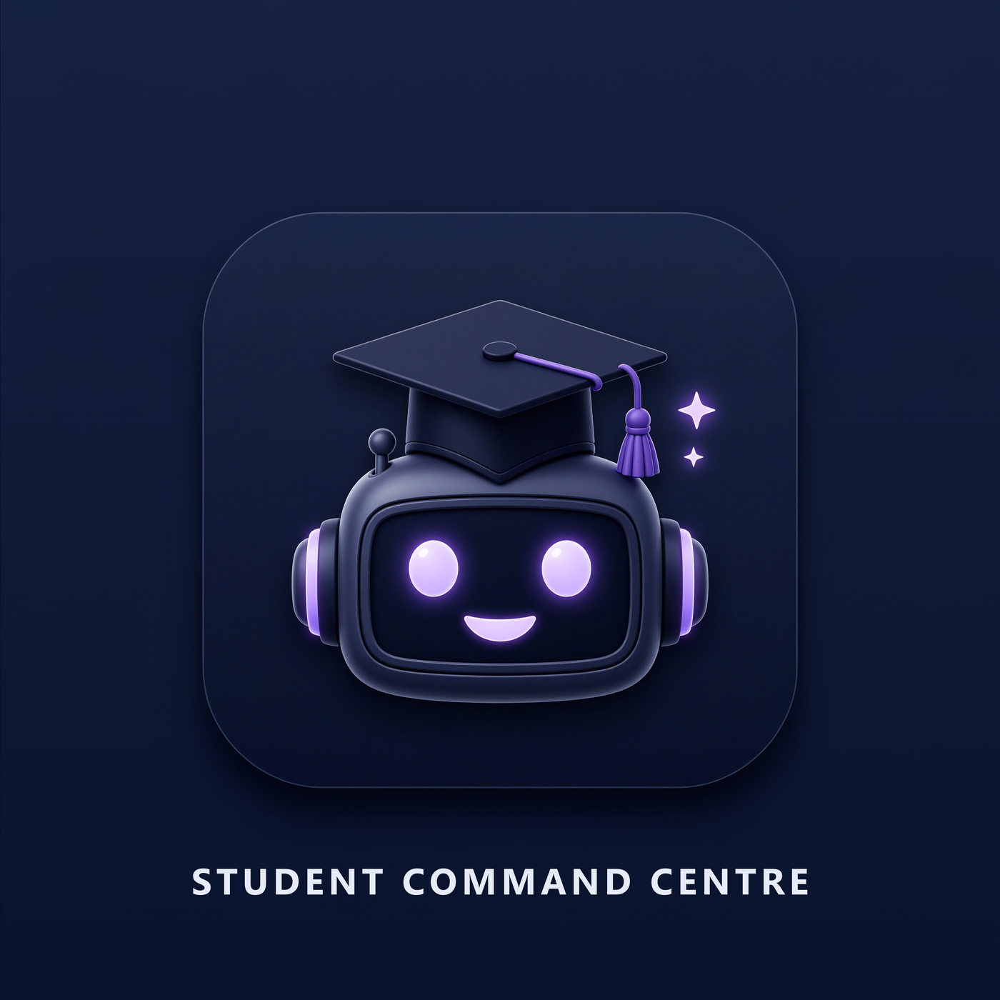
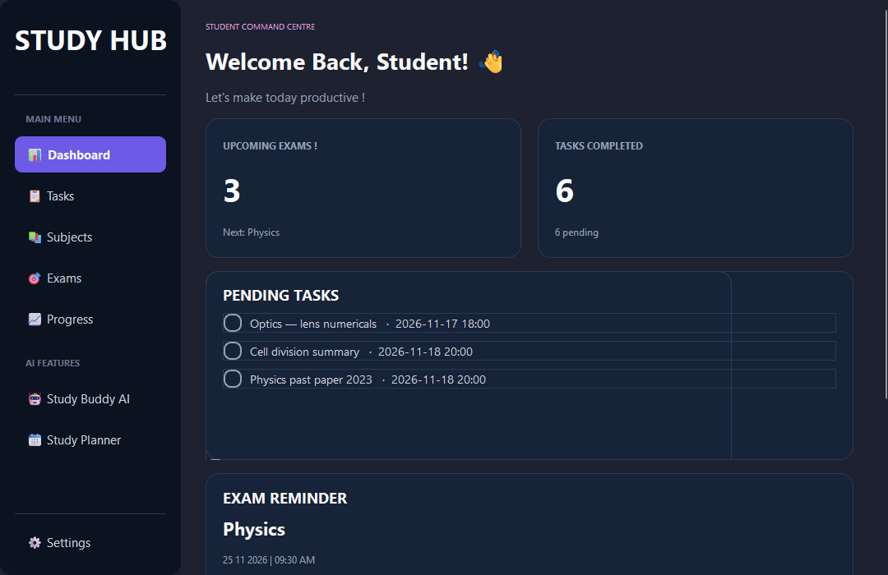
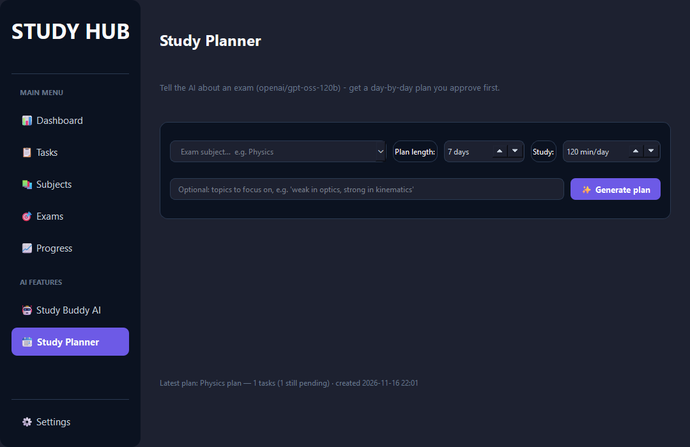
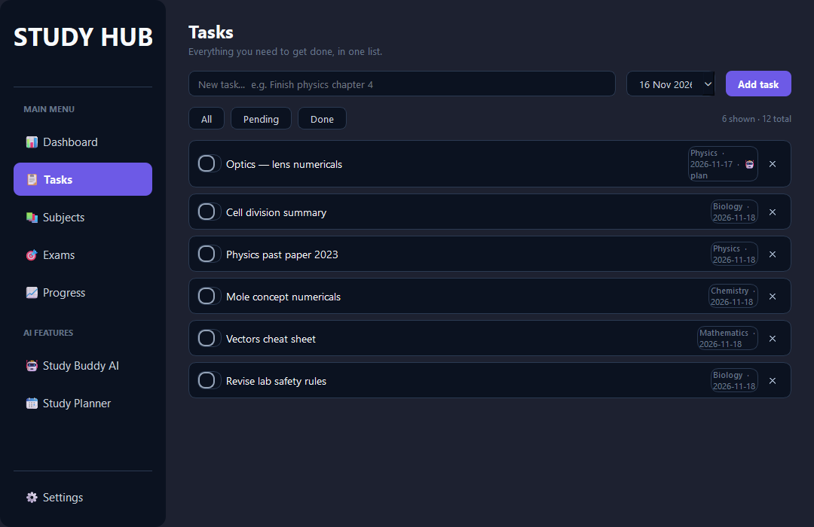
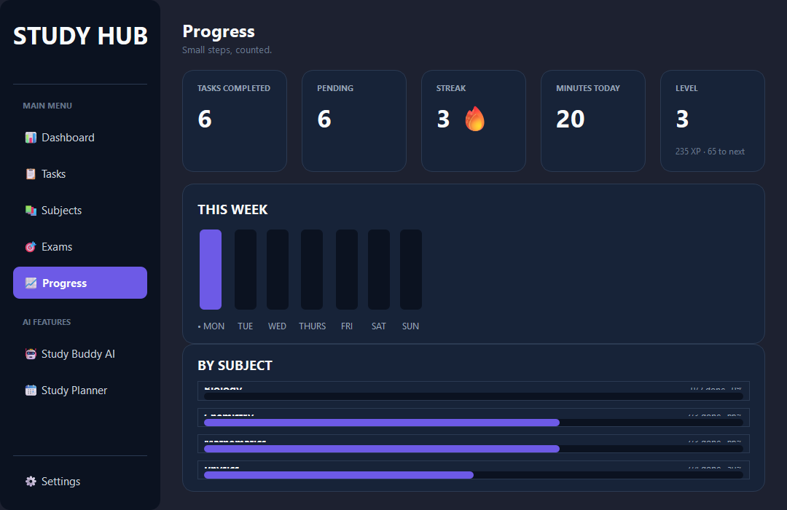

<div align="center">



# Student Command Centre

**Your study hub — with an AI tutor, an AI study planner, and a memory.**

[](https://www.python.org/)
[](https://doc.qt.io/qtforpython/)
[](https://console.groq.com/docs/models)
[](#)
[](https://github.com/Harisudhan77/student-command-center/releases)
[](LICENSE)

A fast, dark, offline-first desktop app that tracks your exams, tasks and
subjects — and adds **GPT-OSS intelligence** on top: a tutor that explains
anything, a planner that turns "I have an exam" into a day-by-day study plan,
timetable PDFs that import themselves, and a reward system that keeps you coming
back.

</div>

---

## ✨ Features

| | Feature | What it does |
|---|---|---|
| 📊 | **Dashboard** | Upcoming exams, tasks completed, pending tasks, exam countdown, weekly activity |
| 📋 | **Tasks** | Add, complete and delete tasks with due dates; filter all / pending / done |
| 📚 | **Subjects** | Manage subjects; see done/pending counts and each subject's next exam |
| 🎯 | **Exams** | Live countdowns ("TODAY!", "tomorrow", "N days") and result logging |
| 📈 | **Progress** | Study streak 🔥, minutes today, weekly chart, per-subject progress bars |
| 🤖 | **Study Buddy AI** | A patient tutor that explains in short steps — powered by **GPT-OSS 120B on Groq** |
| 📆 | **Study Planner** | AI builds a day-by-day plan → you preview it → approve → it becomes real tasks |
| 📄 | **Timetable import** | Drop in your exam timetable PDF; exams are extracted and added automatically |
| 🔔 | **Smart notifications** | System-tray toasts: exam warnings, evening check-ins, due-task digests |
| 🏆 | **XP & rewards** | +15 XP per task, +50 per exam, levels, streak celebrations |
| ⚙️ | **Settings** | Your name, daily study goal, background mode, one-click data reset |

Everything is stored locally in **SQLite** — your data never leaves your machine.

## 📸 Screenshots

| Dashboard | Study Planner |
|---|---|
|  |  |

| Tasks | Progress |
|---|---|
|  |  |

## 🚀 Getting started

### From the packaged build (recommended)

1. Download `StudentCommandCentre-windows-x64.zip` from
   [**Releases**](https://github.com/Harisudhan77/student-command-center/releases)
2. Unzip and run `StudentCommandCentre.exe` — no installation needed
3. For the AI features, grab a **free** API key at
   [console.groq.com/keys](https://console.groq.com/keys) and put it in a
   `.env` file next to the exe:
   ```
   GROQ_API_KEY=gsk_your_key_here
   ```

> Windows SmartScreen may show an "unknown publisher" warning for unsigned
> builds — choose *More info → Run anyway*.

### From source

```bash
git clone https://github.com/Harisudhan77/student-command-center.git
cd student-command-center
pip install -r requirements.txt
python main.py
```

## 🧠 How the AI features work

**Study Buddy** answers in short numbered steps with a worked example, gives
hints before full solutions, and keeps answers compact. Replies stream in live.

**The Study Planner** asks for the exam subject, how many days you have and how
long you study per day — then returns a structured JSON plan that the app
*validates* (day offsets clamped, times normalised, minutes capped) before
showing you a preview. **Nothing is saved until you approve it.**

**Timetable import** reads your PDF, resolves dates like `MON 25 NOV` against
today's date, drops junk rows, de-duplicates against exams you already have,
and shows a confirmation checklist.

The model falls back from `gpt-oss-120b` to `gpt-oss-20b` automatically if the
primary model is unavailable.

## 🔔 Notifications & rewards

The app lives in the **system tray** — closing the window keeps it running in
the background (toggle in Settings) so reminders keep firing:

- 🎉 task completed → praise + **+15 XP**
- 🎓 exam day evening & morning after → *"How did it go?"* → **+50 XP**
- 📚 upcoming exams → at 3 days, 1 day and the exam morning
- 📋 tasks due today / overdue → one digest per day
- 🔥 streak milestones and 🚀 level-ups

Every reminder fires at most once per item per day — never spam.

## 🌐 Web version

The same AI brain runs in your browser via a FastAPI backend:

**[student-command-center-ten.vercel.app](https://student-command-center-ten.vercel.app)**

Source lives in [`web/`](web/) (Groq key configured as an environment variable).

## 🗂️ Project structure

```
main.py            window shell: sidebar + page stack
store.py           SQLite storage (tasks, exams, subjects, plans, XP, settings)
ui_theme.py        shared colors & styles
dashboard.py  tasks.py  subjects.py  exams.py
progress.py   planner.py  settings.py
study_buddy.py     chat page (embeddable widget)
timetable.py       exam timetable PDF import
notify.py          system-tray toasts
rewards.py         XP, levels and praise
reminders.py       scheduled reminder logic
web/               FastAPI web version (Vercel)
tests/             logic tests (store, reminders, AI parsing)
```

## 🧪 Tests

```bash
python tests/test_store.py
python tests/test_rewards_and_reminders.py
python tests/test_ai_parsing.py
```

## 📦 Building the .exe

```bash
pip install pyinstaller
python -m PyInstaller --noconfirm --clean --onefile --windowed ^
    --name StudentCommandCentre --icon assets/app_icon.ico ^
    --add-data "assets/app_icon.png;assets" ^
    --add-data "assets/logo_lockup.png;assets" main.py
```

## ⚙️ Configuration

All configuration is optional — put these in `.env`:

| Variable | Default | Purpose |
|---|---|---|
| `GROQ_API_KEY` | — | Required for AI features ([free key](https://console.groq.com/keys)) |
| `STUDY_BUDDY_MODEL` | `openai/gpt-oss-120b` | Swap the model (e.g. `openai/gpt-oss-20b`) |
| `STUDY_BUDDY_REASONING` | `low` | Reasoning effort: `low` / `medium` / `high` |
| `STUDY_BUDDY_WEB_CODE` | off | Optional access code protecting the web version |

## 🗺️ Roadmap

- [ ] Exam timetable image (photo) import via OCR
- [ ] Plan editing after approval
- [ ] Cloud sync between devices
- [ ] Weekly email/push digest

## 📄 License

Proprietary — see [LICENSE](LICENSE). The packaged app is available for
purchase; the source is shared for transparency and personal use.

---

<div align="center">
Built with PySide6, SQLite and GPT-OSS on Groq.
</div>
